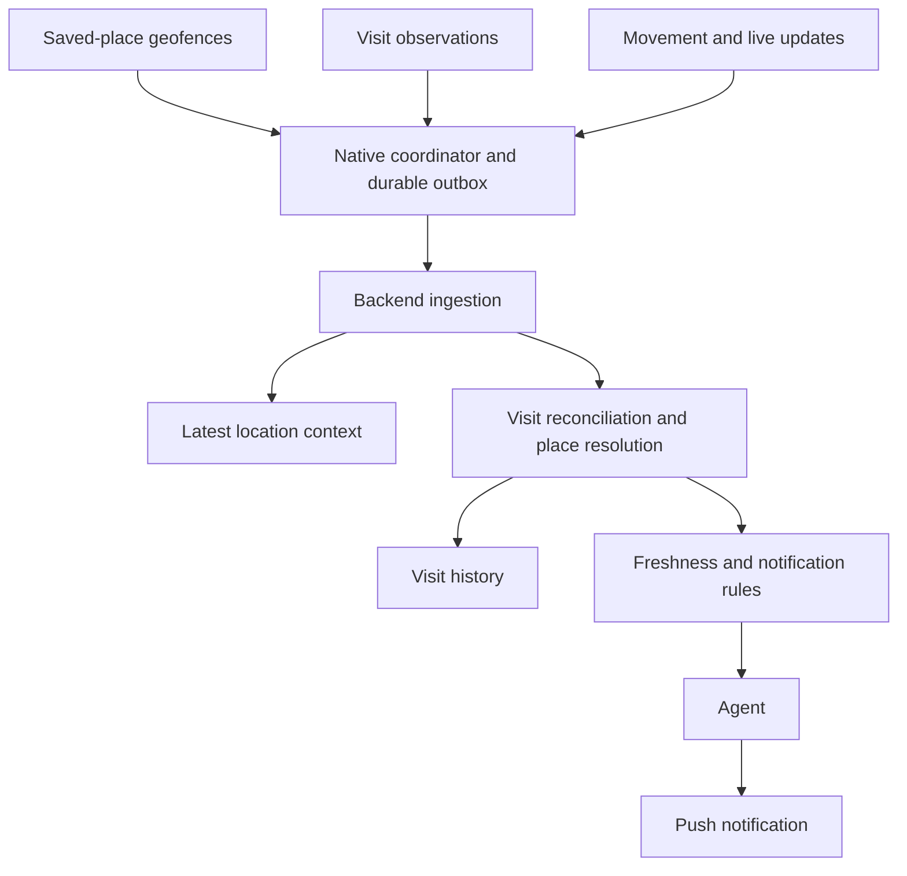

**Yes—this is a good fit for a native iOS location service feeding your backend.** I’d use **Core Location for movement and arrival signals, your own saved-place records for “Home” and “Office,” and a places lookup to identify businesses.** Your backend can then turn those observations into events the agent reacts to.

The main product decision is **how quickly you need to recognize a new place**. “Welcome home” is a straightforward geofencing use case. “You just entered a previously unknown coffee shop; here’s what to order” needs fresher location data and more inference.

For your app, I’d build a battery-friendly background mode first, with an optional mode for more timely location updates.

## 1. Use several location mechanisms together

iOS offers complementary APIs for the different parts of this experience:

| What you want | Mechanism I’d use | What to expect |
|---|---|---|
| Arrive at or leave **Home, Office, or a saved favorite** | `CLMonitor` with circular geographic conditions | iOS monitors the area and can wake your app when its state changes. This is the right foundation for known-place triggers. |
| Discover **places the user stops at** | `CLLocationManager.startMonitoringVisits()` | Provides a visit’s coordinates, accuracy, and approximate arrival/departure times. Business identification is a separate step. |
| Keep a useful **last-known location while traveling** | `startMonitoringSignificantLocationChanges()` | Coarse movement updates. Apple describes movement of roughly 500 meters or more and says not to expect updates more often than every five minutes. |
| React more quickly to **new stops** or provide **live location sharing** | `CLLocationUpdate.liveUpdates()` | A more active location stream, with automatic stationary detection and pause/resume behavior. This requires careful background lifecycle and energy management. |

These capabilities and limits are documented separately by Apple; in particular, significant-change monitoring is unsuitable as a precise, frequent heartbeat. [Apple Developer Documentation](https://developer.apple.com/documentation/CoreLocation/monitoring-the-user-s-proximity-to-geographic-regions?changes=la__7_6\&language=objc\&utm_source=chatgpt.com)

One detail for a new implementation: **visits and significant-change updates still use `CLLocationManager` delegates**, even if you use the newer Swift concurrency APIs for geofences and live updates. Apple confirmed that combination in June 2026. [Apple Developer Forums](https://developer.apple.com/forums/thread/791470?utm_source=chatgpt.com)

I would put all of these behind one native `LocationCoordinator`, so the rest of your app receives a consistent set of observations.

## 2. Home and Office should be your own saved places

Let the user select a location through a map search, a dropped pin, or “use my current location,” then attach a private label.

I’d store something like:

| Field | Purpose |
|---|---|
| `place_id` | Your stable internal identity |
| `label` | Home, Office, Gym, etc. |
| `center` | Latitude/longitude for the saved area |
| `radius_m` | The monitored arrival/departure boundary |
| `provider_place_id` | Optional public business identity |
| `confirmed_by_user` | Distinguishes a deliberate choice from an inference |
| `notification_preferences` | Whether this place should produce proactive alerts |

A home doesn’t need to correspond to a public business listing. Likewise, “Office” might refer to one tenant in a building.

### Register a geofence for each important place

For a modern implementation, use `CLMonitor` and a circular geographic condition. The system handles monitoring while your app is inactive and wakes it for relevant changes.

There is a limit of **20 simultaneously monitored conditions per app**. I’d reserve slots for Home and Office, then use the remaining capacity for important favorites and relevant nearby saved places. A large saved-place collection can live in your database; only a selected subset needs active monitoring. [Apple Developer Documentation](https://developer.apple.com/documentation/CoreLocation/monitoring-the-user-s-proximity-to-geographic-regions?changes=la__7_6\&language=objc\&utm_source=chatgpt.com)

For an initial prototype, I’d experiment with a **100–200 meter radius** for Home and Office. That is an engineering starting point to test, not an Apple accuracy or latency guarantee.

The radius creates a practical tradeoff:

- A larger area tends to recognize arrival earlier, but can include nearby streets and businesses.
- A smaller area represents the property more closely, but gives location uncertainty more opportunity to affect the result.

The event means **the phone entered the saved area**. Your application decides when that is sufficient evidence to say “Welcome home.”

### Maintain state across observations

I’d explicitly track whether the user is:

- Outside a saved place.
- Possibly arriving.
- Considered present.
- Possibly departing.

This lets you suppress boundary jitter and merge overlapping evidence. For example, a Home geofence entry followed by a visit observation should produce one arrival, not two greetings.

Also distinguish **initial state** from **a transition**. If someone enables the feature while already sitting at home, initialize their context to Home without necessarily treating that as a new arrival.

## 3. Identifying an unfamiliar coffee shop is a separate inference problem

There are three different assertions:

1. The phone was observed around these coordinates.
2. The user appears to have stopped there.
3. The stop was at a particular business.

Your system should preserve the distinction.

### Use visit monitoring for passive discovery

`CLVisit` gives you a coordinate, horizontal accuracy, and approximate arrival/departure times. An event may contain only an arrival, or it may describe a completed visit with both times. [Apple Developer Documentation](https://developer.apple.com/documentation/corelocation/clvisit?utm_source=chatgpt.com)

That is useful for building context such as:

> “The user spent part of the afternoon around this location.”

However, **a visit callback is not a promise of an immediate arrival notification**. I would use it for low-power place discovery and visit history, while checking freshness before allowing it to trigger a time-sensitive recommendation.

If a callback describes a visit that has already ended, it belongs in history. It should not trigger “You’re at Sightglass.”

### Find candidate businesses with a places API

For an Apple-first implementation:

- Use **`MKLocalPointsOfInterestRequest` with `MKLocalSearch`** to find nearby businesses around a stop.
- Use **Apple Maps place identifiers** to retain references to resolved businesses.
- Use the **Apple Maps Server API** for supported search and place enrichment on your backend.

MapKit’s nearby POI request supports a circular search area and category filtering. Apple also documents persistent, shareable place identifiers, while its server API exposes location-biased search. [Apple Developer Documentation](https://developer.apple.com/documentation/mapkit/mklocalpointsofinterestrequest?changes=_2_6\&utm_source=chatgpt.com)

**Reverse geocoding alone does not solve business identification.** Apple explicitly says that the result of its newer reverse-geocoding API contains address-point information rather than rich POI information. An address shared by several businesses cannot establish which one the user visited. [Apple Developer](https://developer.apple.com/videos/play/wwdc2025/204/?utm_source=chatgpt.com)

For a resolver that runs entirely on your backend, **Google Places Nearby Search (New)** is another option. It accepts a geographic search area and returns candidate places; selected response fields affect billing. I’d compare it with Apple against actual visits in your target cities before choosing based on presumed coverage. [developers.google.com](https://developers.google.com/maps/documentation/places/web-service/nearby-search?utm_source=chatgpt.com)

Keep provider content separate from your own observations and user labels. For example, Google permits indefinite storage of place IDs but has restrictions on other cached content and attribution requirements. That affects how you design the place database. [developers.google.com](https://developers.google.com/maps/documentation/places/web-service/policies?utm_source=chatgpt.com)

### Resolve the venue using several signals

My suggested resolution order would be:

1. **Check user-confirmed saved places.** Home should take precedence over an unrelated business near the house.
2. **Check whether there is evidence of a stop.** Passing a café and visiting it should produce different outcomes.
3. **Find nearby candidates.** Search broadly enough that you don’t force every stop to match a coffee shop.
4. **Compare candidates against the location uncertainty.** A nearby POI is less persuasive when several others fit equally well.
5. **Use repeated observations and confirmed history.** A user correction on an earlier visit can help resolve later visits.
6. **Keep ambiguous results ambiguous.** “Stopped near Sightglass” is a valid state.

I would maintain two separate confidence assessments:

- **Visit confidence:** how sure are we that this is a stop?
- **Venue confidence:** how sure are we which place it is?

You can be confident that someone stopped in a building while remaining uncertain which of its four businesses they entered.

A lightweight correction UI—“Was this Sightglass?”—can make the system improve without presenting guesses as facts. Use confidence categories such as `confirmed`, `high`, `ambiguous`, and `unknown` unless you have calibrated numerical probabilities.

## 4. Timely café recommendations require a deliberate freshness strategy

This is the part I would decide explicitly before promising the experience.

### Battery-friendly background mode

I’d enable:

- Saved-place geofences.
- Visit monitoring.
- Significant-change monitoring if the agent needs coarse location context between visits.

This is a good default for:

- Home and Office arrivals.
- Discovering habitual places.
- Maintaining visit history.
- Giving the agent useful last-known context.

It will have gaps in how promptly it recognizes unfamiliar, short visits.

### More timely location mode

When users enable more responsive contextual assistance or live sharing, use `CLLocationUpdate.liveUpdates()` with the appropriate background authorization and lifecycle.

The modern stream supports automatic stationary detection and resumes updates when movement returns. Apple also emphasizes that higher accuracy and continued background updates consume more energy. [Apple Developer Documentation](https://developer.apple.com/documentation/xcode/accessing-the-device-s-location-efficiently?changes=_1_4\&language=objc\&utm_source=chatgpt.com)

I’d use that stream to:

- Detect movement slowing or stopping.
- Accumulate evidence for a candidate visit.
- Resolve nearby venues.
- Emit an arrival event once the evidence is sufficient.

A dwell rule—such as requiring consistent observations over a short interval—is your product policy, and should be tuned through testing.

Two subtleties matter here:

**First, a timer is not evidence of continued presence.** If you receive one fix and then the app becomes suspended, “three minutes have elapsed” does not prove the user stayed for three minutes. Confirmation should rely on additional location or visit evidence.

**Second, waiting for a confident visit may be too late for an ordering recommendation.** For known favorite cafés, you might deliberately use a proximity trigger:

> “Near Sightglass? You wanted to try their cold brew.”

That can fire on approach. A message asserting that the user is already inside should require stronger evidence.

I’d measure both detection quality and battery use before setting a latency expectation. Sending fewer uploads reduces networking work, but does not by itself reduce the cost of an underlying active location stream.

## 5. Implement background authorization and restoration carefully

For an ongoing, user-enabled ambient feature, I’d design around **Always authorization**, with **Precise Location** for geofences and venue-level behavior.

A reasonable permission flow is:

1. The user enables location awareness.
2. You explain what the agent will receive and what the feature does.
3. Request location access in context.
4. Request Always access when enabling background arrivals and visits.
5. Request notification permission separately when enabling proactive messages.

The project needs the appropriate purpose strings, including:

- `NSLocationWhenInUseUsageDescription`
- `NSLocationAlwaysAndWhenInUseUsageDescription`

For active background location updates, configure **Background Modes → Location updates**. [Apple Developer Documentation](https://developer.apple.com/documentation/corelocation?changes=l_3\&utm_source=chatgpt.com)

Precise Location matters beyond improving the quality of a business guess: Apple documents that geographic-region entry/exit notifications require full accuracy. Reduced-accuracy visit events can still arrive, but with coarse spatial information. Your app should expose that degraded capability clearly. [Videos](https://developer.apple.com/videos/play/wwdc2020/10660/?utm_source=chatgpt.com)

### The modern session objects have different jobs

For the modern APIs:

- **`CLServiceSession`** expresses the authorization needed by the feature.
- **`CLMonitor`** delivers monitored-condition changes.
- **`CLLocationUpdate`** delivers location updates.
- **`CLBackgroundActivitySession`** supports continued background use for a When In Use-authorized activity, with the associated visible location indication.

For Always-authorized passive monitoring, a continuously held background activity session is not universally required. Apple documents the background activity and Always-authorization paths separately. [developer.apple.com](https://developer.apple.com/documentation/corelocation/clbackgroundactivitysession-3mzv3?utm_source=chatgpt.com)

For an iOS 18+ implementation using the modern streams, retain an explicit Always service session for the enabled feature. Start the feature while the app is in the foreground, persist its enabled state, and **restore the session and event consumers promptly after relaunch**. This belongs in native application startup rather than depending on a particular screen being loaded. Apple’s session lifecycle guidance is explicit about restoring interrupted sessions. [Apple Developer](https://developer.apple.com/videos/play/wwdc2024/10212/?utm_source=chatgpt.com)

### Treat suspension, termination, and force-quit separately

Modern Core Location APIs support recovery through suspension and system termination when configured correctly. There is also an important correction to older advice: an Apple engineer states that newer APIs can function even after force-quit in the discussed live-update/background-session configuration. That should not be generalized to every location mechanism or every networking task. [Apple Developer Forums](https://developer.apple.com/forums/thread/772076?utm_source=chatgpt.com)

I’d test your exact configuration on physical devices, including:

- Locked screen and extended inactivity.
- System termination and user force-quit.
- Reboot and first unlock.
- Permission and precision changes.
- Poor connectivity and offline recovery.
- Low Power Mode and Background App Refresh settings.

Apple specifically notes that geographic monitoring after reboot starts only after the user unlocks the device. [Apple Developer Documentation](https://developer.apple.com/documentation/CoreLocation/monitoring-the-user-s-proximity-to-geographic-regions?changes=la__7_6\&language=objc\&utm_source=chatgpt.com)

The app should expose monitoring status and last-update time so that gaps are visible to both the user and the agent.

## 6. Upload observations quickly, then do the expensive work on the backend

I would structure the system like this:



The phone’s critical path should be short:

1. Receive an observation.
2. Persist it locally.
3. Attempt a small authenticated HTTPS upload.
4. Remove it from the outbox only after the backend acknowledges it.
5. Retry unacknowledged events on subsequent opportunities.

Give every observation an event ID. The backend should accept retries idempotently and acknowledge ingestion before waiting for a places provider or an agent run.

### Use ordinary networking during the available execution window

For a small arrival event, I’d attempt an ordinary `URLSession` request while the app is executing. If appropriate, use a bounded background task to finish the operation, with expiration handling.

A background `URLSession` file transfer can support eventual delivery, but it has different scheduling behavior: **Apple says transfers initiated while the app is already backgrounded are discretionary, even if `isDiscretionary` was set to false.** That makes it a poor sole mechanism for timely arrival alerts. [Apple Developer Documentation](https://developer.apple.com/documentation/uikit/uiapplication/beginbackgroundtask%28withname%3Aexpirationhandler%3A%29?language=occ%2Cocc%2Cocc%2Cocc\&utm_source=chatgpt.com)

The outbox lets you recover from failure without keeping the phone waiting for the agent. Place resolution, recommendation generation, and push delivery can happen asynchronously on your backend.

## 7. Give the agent interpreted events and explicit freshness

I would expose two interfaces to the agent:

### A readable location-context tool

For example:

```text
get_location_context()
```

It should return:

- Last observed coordinates and accuracy, when available.
- Observation time.
- Last known place.
- How that place was identified.
- Whether current presence is confirmed, inferred, or stale.
- Whether location sharing is enabled.

Keep actual coordinate measurements separate from place state. A Home geofence event can establish that the phone is within the saved area without establishing its exact position at the center of that area.

### A stream of meaningful events

For example:

```text
place.arrived
place.departed
visit.confirmed
location.context_changed
```

Most raw fixes should update state. I’d invoke the agent for meaningful changes or explicit user rules.

An illustrative normalized event could look like:

```json
{
  "event_id": "evt_123",
  "type": "place.arrived",
  "visit_id": "visit_456",
  "arrived_at": "2026-10-23T10:08:00-07:00",
  "observed_at": "2026-10-23T10:09:30-07:00",
  "received_at": "2026-10-23T10:09:32-07:00",
  "place": {
    "id": "place_789",
    "name": "Sightglass Coffee",
    "private_label": null,
    "resolution": "inferred",
    "confidence": "high"
  },
  "presence": {
    "status": "likely_present",
    "last_evidence_at": "2026-10-23T10:09:30-07:00"
  },
  "evidence": [
    "consistent_location_observations",
    "previously_confirmed_venue"
  ]
}
```

Those timestamps have different purposes:

- **`arrived_at`** describes the inferred event in the world.
- **`observed_at`** describes the supporting observation.
- **`received_at`** describes network delivery.

A late upload can update history without masquerading as a new, current arrival.

### Apply notification rules before and after the agent runs

I’d make these deterministic:

- Suppress duplicate arrivals from multiple location sources.
- Reject stale arrivals for time-sensitive messages.
- Suppress venue-specific claims when identity is ambiguous.
- Recheck presence before sending if the agent took time to respond.
- Apply a per-visit notification limit and a cooldown.
- Respect the user’s settings for each place and notification category.

Also keep **location evidence** separate from **recommendation evidence**. Knowing the user is at a particular café does not establish what is currently on its menu. The agent can use a remembered preference, verified venue information, or appropriately qualified wording.

For recurring places, I’d also allow the agent to save a future rule—for example, “remind me about this next time I’m near Sightglass”—so that subsequent arrivals can trigger an already prepared action.

## 8. On-demand location refresh has an important limitation—and an exception

If the agent asks “Where are you right now?”, your default should be to return the latest known context **with its age**.

A normal silent push is a best-effort way to request activity. Apple explicitly says background notification delivery is not guaranteed and can be throttled. Similarly, `BGTaskScheduler` cannot guarantee execution at a requested time, so it is not a reliable “check location every minute” mechanism. [Apple Developer Documentation](https://developer.apple.com/documentation/usernotifications/pushing-background-updates-to-your-app?changes=latest_minor\&utm_source=chatgpt.com)

There is a more specialized API: **Location Push Service Extension**.

It lets a server send an APNs `location` push that activates an extension to obtain location, even when the main app is not running. It requires Always authorization and the relevant capability. However, Apple documents it for:

- Sharing location with other people the user explicitly approves.
- Certain time-sensitive medical emergency/first-responder apps.

It is also rate-limited. **A personal-agent-only location feature should not assume it qualifies.** If you later add actual person-to-person location sharing, it is worth evaluating for on-demand refresh. [Apple Developer Documentation](https://developer.apple.com/documentation/corelocation/creating-a-location-push-service-extension?utm_source=chatgpt.com)

I would build the core arrival/visit architecture without depending on that extension.

## What I would build first

For your first release, my implementation order would be:

| Stage | Deliverable | What it establishes |
|---|---|---|
| **1. Saved places** | Home/Office picker, geofences, durable upload, backend arrival/departure state | Reliable handling of your clearest use case |
| **2. Passive discovery** | Visit monitoring, nearby-place resolution, user corrections | A useful history and a growing set of recognized places |
| **3. Agent integration** | Location-context tool, semantic events, freshness checks, notification preferences | Useful agent behavior without duplicate or outdated prompts |
| **4. More timely tracking** | Optional live stream and stop inference | Better responsiveness at previously unknown places |
| **5. Field tuning** | Measure detection delay, missed visits, wrong venue matches, and battery use | Evidence for the promises you can make to users |

**My starting stack would be native Swift Core Location, MapKit for place selection and nearby POIs, a durable on-device event queue, and a backend place/visit service feeding the agent.** Keep the provider integration replaceable so you can evaluate another places catalog against real results.

The success criterion I’d focus on first is: **a recognized arrival produces one useful, timely event, with enough evidence for the agent to know what it can safely infer.** That gives you a solid foundation for both “Welcome home” and increasingly contextual recommendations.
